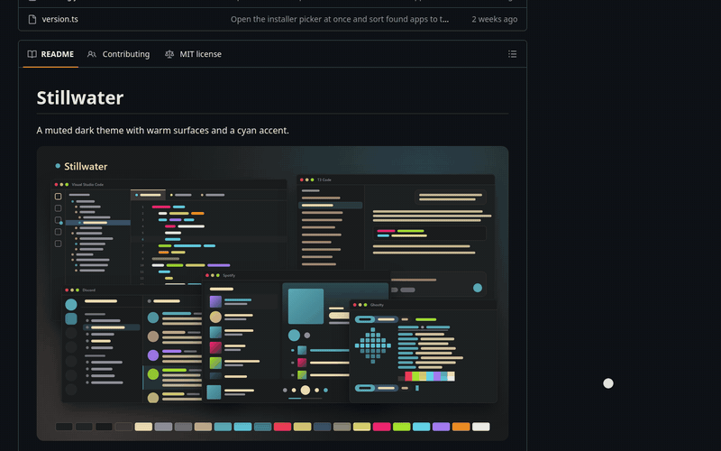

[lightbox-demo-30fps.webm](https://github.com/user-attachments/assets/b60bcbc2-f99e-49d0-a028-184c62b16cbb)
# Image Lightbox

A Firefox extension (it also runs in Zen and other Firefox-based browsers). On supported sites, clicking an image opens it in an overlay on the same page instead of sending you to a new tab.



- Images open at their real size, shrunk to fit the screen if needed.
- Click the image to zoom in at that point, and click again to fit. The mouse wheel zooms around the cursor, and you drag to pan.
- `←` / `→` step through the other images on the page.
- `Esc`, the ✕, or a click on the backdrop closes it.
- Ctrl/Shift/middle-click still open the link as usual. "Open original" opens it in a new tab.

## Supported sites

| Site | Hosts | What opens |
| --- | --- | --- |
| Cardmarket | `www.cardmarket.com`, `cardmarket.com` | Card images on product pages and in the gallery view of search and singles pages, and the camera icon in list views, wants lists, and the Shopping Wizard (it opens the image from its hover tooltip). Card images that another extension or userscript adds also open, and then the camera icon beside them steps aside. The expansion symbols under "Reprints" still link to that printing, and clicking a card's name still opens its page. Cardmarket serves one size per card (255×361 for Magic), so the lightbox opens that at real size; click or scroll to zoom. |
| GitHub | `github.com`, `gist.github.com` | Linked images in READMEs, issues, pull requests, comments, and gists. Badges that link somewhere else (CI, crates.io, and so on), avatars, and emoji keep their normal behavior. |

## Install

The extension is not on addons.mozilla.org, so the `.xpi` is unsigned. Firefox Developer Edition, Nightly, ESR, and Zen can install unsigned add-ons. Release and Beta Firefox ignore the setting below, so there you can only load it as a temporary add-on.

1. Set `xpinstall.signatures.required` to `false` in `about:config`.
2. Download `image-lightbox.xpi` from the [latest release](https://github.com/AkiVonAkira/github-image-lightbox/releases/latest), or build it from source (below).
3. Open the `.xpi` in the browser (drag it into a window, or about:addons, gear menu, **Install Add-on From File**) and click **Add**.

To try it without installing, open `about:debugging#/runtime/this-firefox`, click **Load Temporary Add-on**, and pick `dist/extension/manifest.json` from a source build. It stays until the browser restarts.

## Build from source

Needs [Bun](https://bun.sh).

```sh
bun scripts/build.ts
```

This writes `dist/extension/` (the unpacked extension) and `dist/image-lightbox.xpi`. To update an installed copy, bump `version` in `src/manifest.json`, rebuild, and install the new `.xpi` over the old one.

## Adding a site

The lightbox in `src/lightbox.js` knows nothing about any site. Each site is one file in `src/sites/` that registers an adapter:

```js
(globalThis.imageLightboxSites ??= []).push({
  id: "example",
  hosts: ["example.com", "www.example.com"], // exact hostnames
  candidates: "article img",                 // CSS selector for elements that may open, in page order
  accepts: (img) => !img.matches(".avatar, .emoji"), // false keeps the click as it is
  fullSize: (img) => img.currentSrc || img.src,      // URL shown in the overlay
  original: (img) => img.closest("a")?.href,         // "Open original" link; falls back to fullSize
  closeOn: [],                                       // extra document events that close the overlay
});
```

Candidates are usually ``, but any element works: a click anywhere inside one opens it, and the gallery skips candidates that are not rendered. `src/sites/github.js` is a full example, and `src/sites/cardmarket.js` opens icons whose image is only in a tooltip. The build loads every file in `src/sites/`, adds it to the content scripts before `lightbox.js`, and turns each adapter's `hosts` into the manifest's `content_scripts.matches`, so you do not edit `manifest.json`. Rebuild and load `dist/extension/manifest.json` as a temporary add-on to test.

## License

MIT. See [LICENSE](LICENSE).
